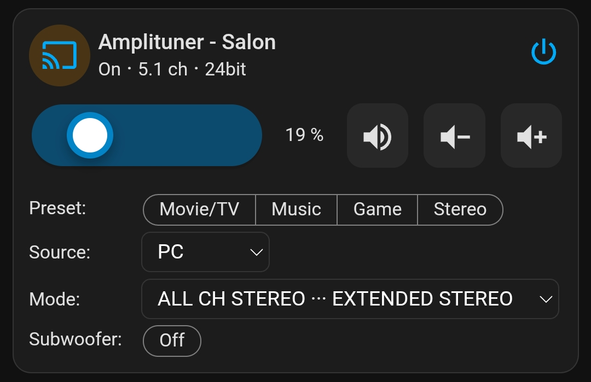
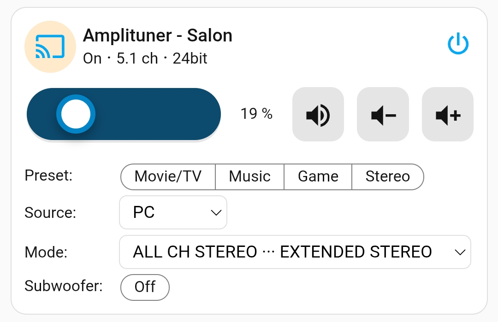
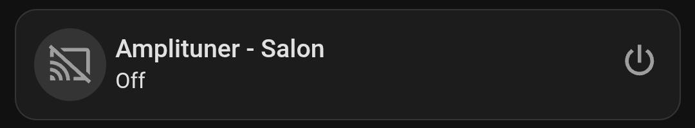
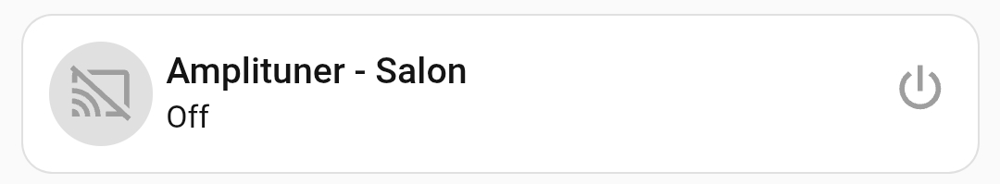

# AV receiver

A media player card for an AV receiver, built with a global HTML/CSS template and custom CSS.

The volume slider shows Home Assistant's `volume_level` (0–1) as 0–100% through Rescale (`scale_in_*` 0–1, `scale_out_*` 0–100). The receiver integration maps that fraction onto the amplifier's own scale, so 100% is the top of that scale. Change `scale_out_max` only if you want the slider to show the receiver's own numbers instead of a percentage.

Add a new card to the dashboard and overwrite its entire configuration with the [av-receiver.yaml](av-receiver.yaml) file (remember to replace the entities with your own).

