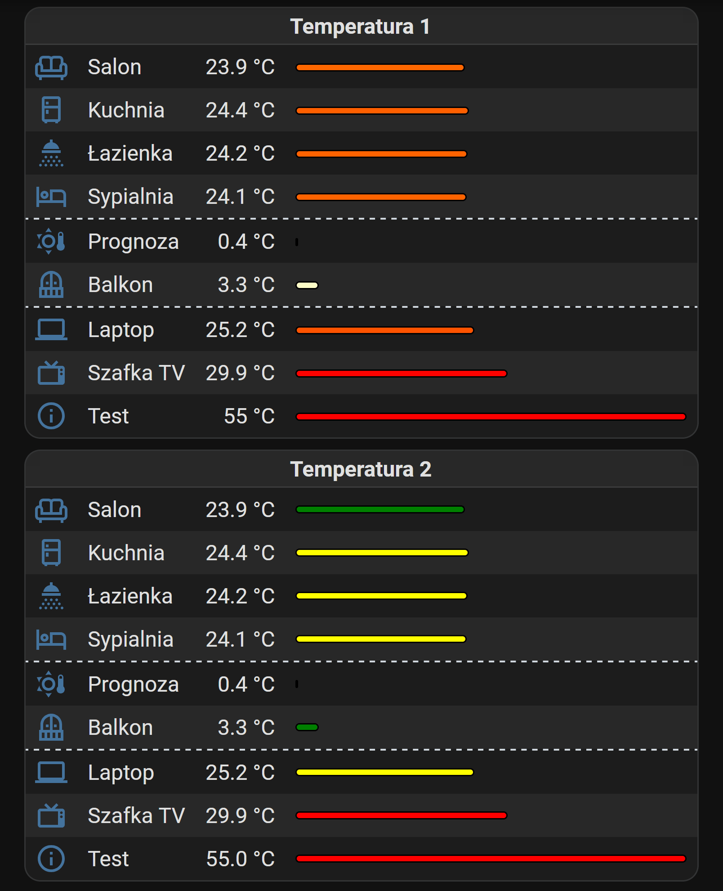
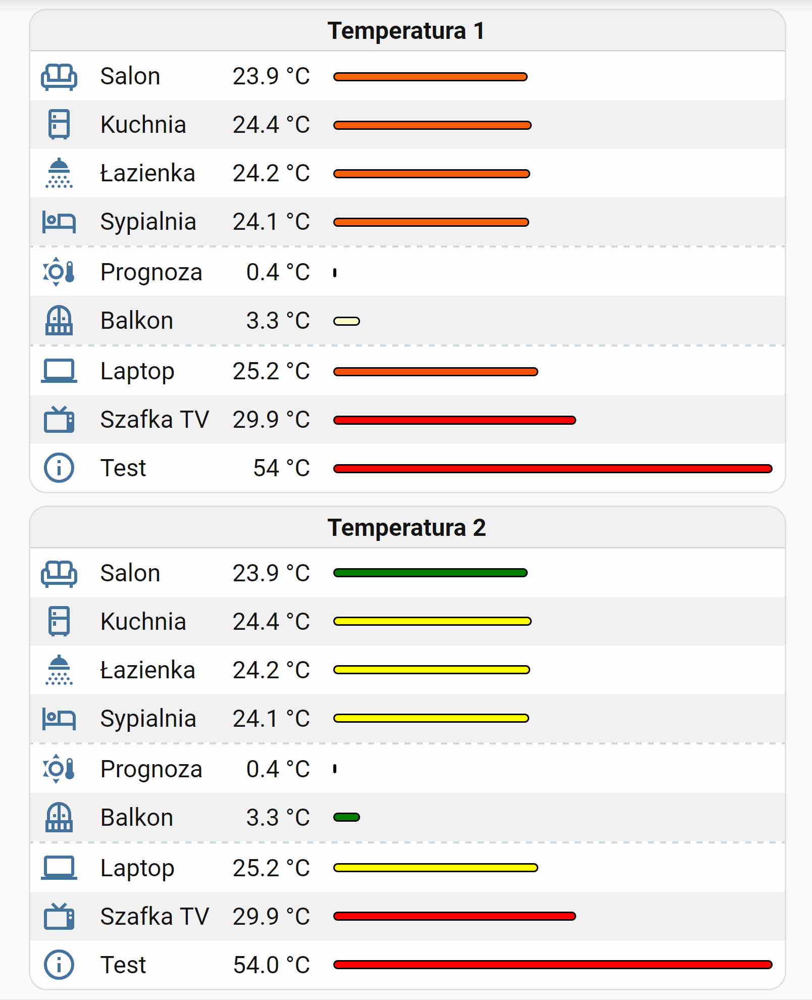

# Dynamic color and size

Two temperature tables. Each row has an icon, a name, the reading, and a bar. The longest bar fills its column. Every other bar is shorter in proportion to that one.

Both examples measure the bars the same way. They only differ in where the color comes from.

[dynamic-color-and-size-1.yaml](dynamic-color-and-size-1.yaml) paints the bar with a smooth scale, from blue through white and yellow to red.

[dynamic-color-and-size-2.yaml](dynamic-color-and-size-2.yaml) uses ordinary dynamic rules, so the bar jumps between green, yellow, red, and light blue.

## The names that start with `--`

`--temp` and `--temp-max` are CSS variables. A variable is a label for a value. The two dashes are just how CSS writes that label. The name itself can be anything, as long as the cell and the style use the same one.

Each bar writes its own temperature into `--temp`. Both examples use that same label.

`--temp-max` is shared by the whole table. It is the largest distance from zero among the listed readings. A bar at `22` next to a bar at `−10` treats `22` as the longest. A bar at `−30` would be longer than one at `22`, because length uses the absolute value.

The width of a bar is its own temperature divided by `--temp-max`. The winning bar is 100% of the column. Half of that temperature is about half as wide.

`--temp-max` is calculated once, in the card template, as the maximum of every sensor in the table. The `0.1` inside that maximum only matters when every reading is zero, so there is still a number to divide by.

Add a new bar, and add its entity to that same list. Otherwise a higher reading can grow past the column.

The [`<fcc>`](https://github.com/michalowskil/flex-cells-card#card-level-global-template) tags inside the style use `raw`, so the number always has a dot (`21.4`), even when the profile language uses a comma. The temperature shown in the table stays localized. Without `raw`, that comma makes `calc()` and `max()` invalid and the bars disappear.

## Example 1 — color follows the temperature

There are no dynamic rules on the bars. The card style reads `--temp` and mixes red, green, and blue:

- Around `0°C` the bar is close to white. It shifts toward yellow and is yellow at `15°C`.
- From `15°C` the yellow shifts toward red. From `30°C` upward the bar stays fully red.
- Below zero the bar starts as a light blue. It reaches full blue at `−25°C` and stays there for anything colder.

The thresholds are the numbers in the card style (`15`, `30`, and `25`). Change those if you want the colors to move sooner or later.

## Example 2 — color comes from dynamic rules

The bar is painted with the cell color. The cell starts green, and three rules replace that color:

- `0°C` and below: light blue
- from `24°C` to `27°C`: yellow
- above `27°C`: red

Anything between `0°C` and `24°C` stays green. Edit the rule values to move those steps.

Add a new card to the dashboard and overwrite its entire configuration with one of the YAML files above (remember to replace the entities with your own).

